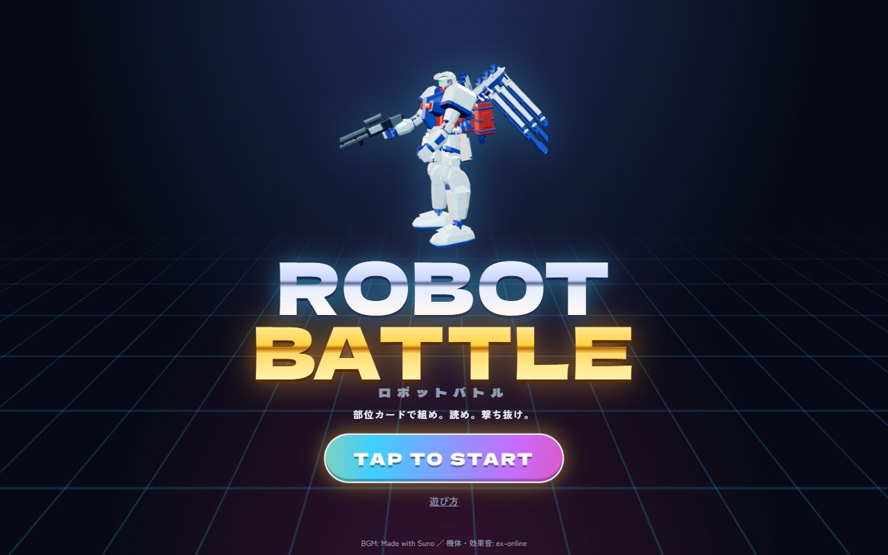
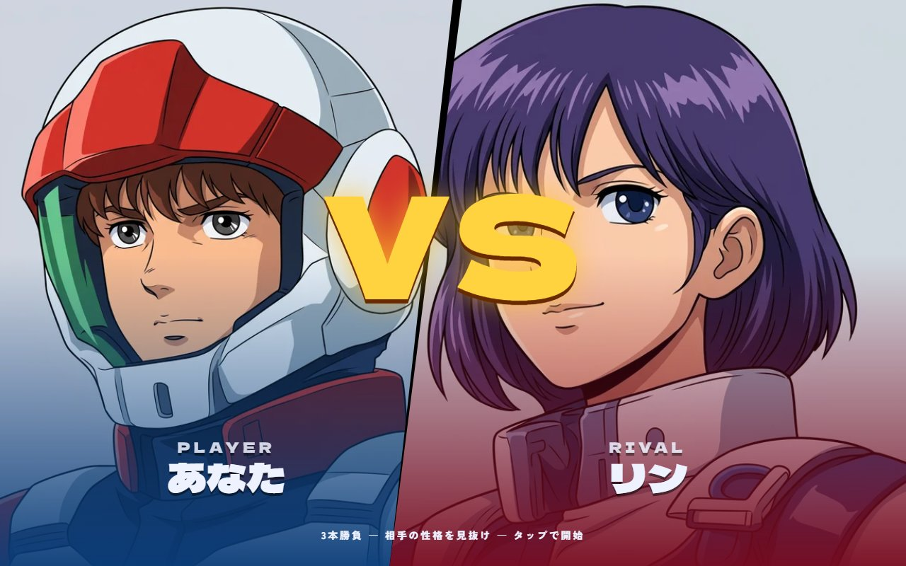
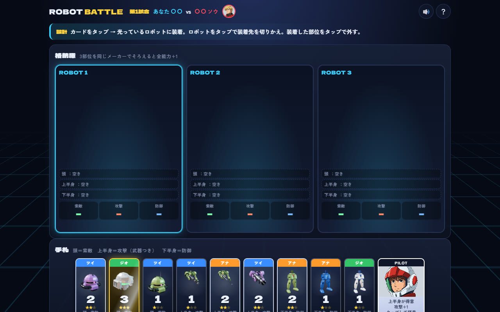
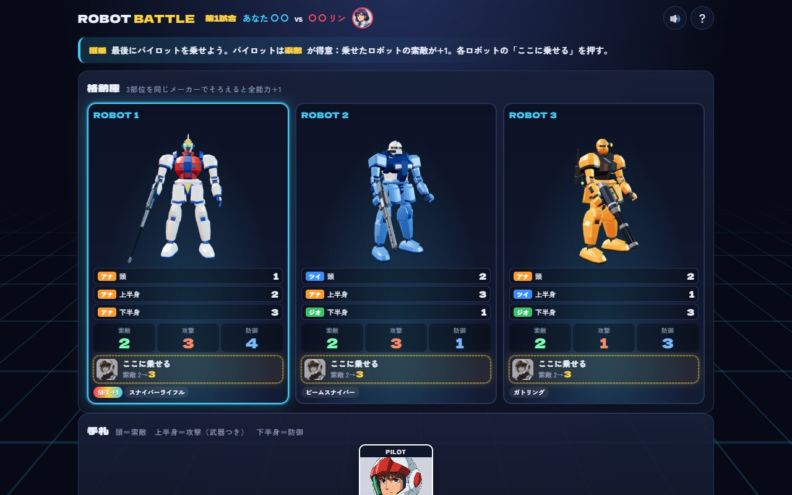
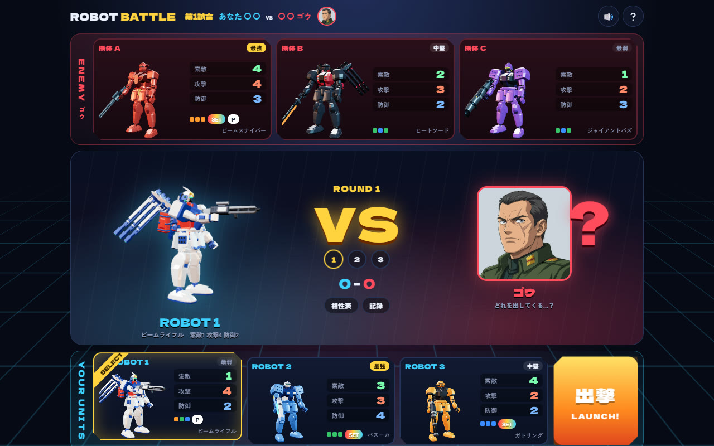
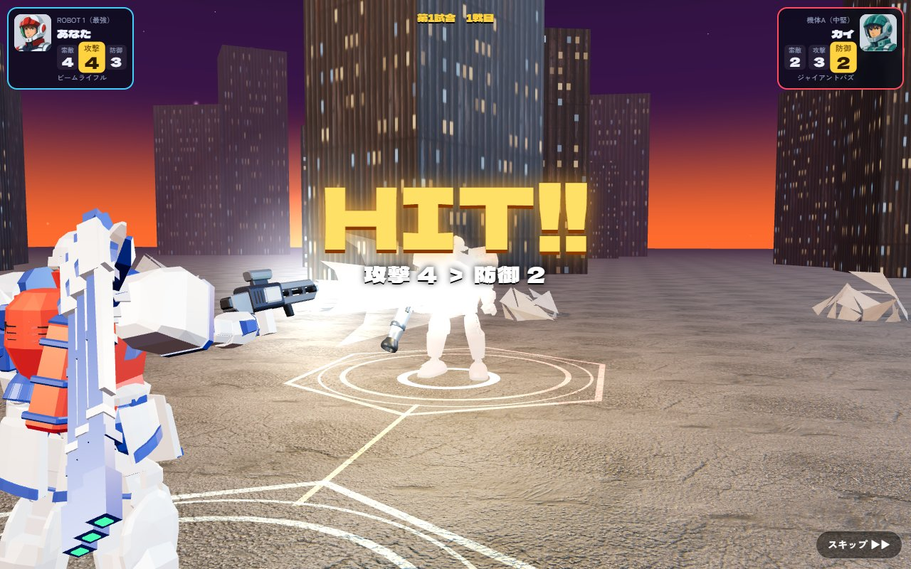

# ロボットバトル

部位カードでロボットを3体組み、性格のあるCPUと3試合戦うカードゲームです。CPUは試合を重ねるうちに、こちらの出し方のクセも読んでくるようになります。

- 遊ぶ：<https://n416.github.io/robot-battle/>
- ルールの元：<https://github.com/n416/microtools/tree/main/robot>

## 流れ

1. タイトル → 相手パイロットとの VS 画面

   
   

2. カード配り（★3 は金色に光る）

   

3. 格納庫で組み立て。部位がはまり、3つそろうと機体がチームカラーに塗られる。同じメーカーでそろえると SET BONUS。パイロットは各ロボットの「ここに乗せる」で乗せる（上がる能力が出る）。下半身カードのいくつかはホバー脚（数字は同じ、脚が浮いてジェットで滑る）

   

4. 設計図公開 → 出撃するロボットを選ぶ → 相手の出した機体がめくれる

   

5. 3D の戦場で戦闘。索敵 → 先制 → 武器ごとの攻撃（ビーム、狙撃、マシンガン、バズーカ、ミサイル、ヒートソード）→ ガードか撃破。脚も動く（着地のしゃがみ、踏み込み、被弾のよろめき、撃破で膝をつく）

   

6. 3試合のあと、相手の性格を当てる

「？」でいまの画面の説明カードが開き、ほかの説明もめくれる。音量は右上（戦闘中は右下）のボタンで、BGM と効果音を別々に変えられる。

画像は `tools/shoot.js` で撮り直せます（下の「スクリーンショットを撮り直す」）。

## ファイル

| ファイル | 中身 |
|---|---|
| `robot-battle.html` | ページ本体（`index.html` はここへ転送するだけ） |
| `game.css` | 画面の見た目 |
| `game.js` | ルール、CPU、画面の流れ、カード配り・組み立て・塗装の演出 |
| `robo3d.js` | 部位を組んだロボット（腕が動き、右手に武器、塗装が足元から上がる）と、カードや格納庫の小さな絵 |
| `battle3d.js` | 戦闘シーン（夕暮れの街、降下、索敵、攻撃、ガード、爆発、撃破） |
| `fx.js` | 画面全体の演出（火花、紙吹雪、フラッシュ、揺れ、大きな文字、カットイン） |
| `sfx.js` | 効果音と BGM（Web Audio） |
| `robot-parts.js` | ex-online の機体から切り出した部位と武器（`tools/extract-parts.js` で作る） |
| `audio/` | ex-online の効果音（mp3 に変換）と BGM |
| `faces/` | パイロットの顔（ex-online） |
| `tex/` | 地面とビルのテクスチャ（ex-online） |
| `tools/extract-parts.js` | 機体の .glb の細かいモデル（`xs_body`。細かさを落としたモデルはひじ・ひざが無く ORB も粗い）と光る部分を、格納庫の立ち姿（ex-online の STAND、いわゆるカトキ立ち）に骨で曲げ、ORB をラックから下向きに吊るしてから、頭・胴・左腕・右腕・下半身に切り出す。各頂点がどの塗装枠（主装甲・副装甲・アクセント）かも記録する。武器の .glb も切り出す |
| `tools/shots.js` `tools/shoot.js` | README のスクリーンショットを撮る（下を参照） |
| `tools/robosim.js` | 性格を読むと得をするかの対戦シミュレーション |
| `tools/robosim2.js` | CPU がこちらのクセを読んだときのシミュレーション |
| `experiments/evolution/` | 先に試した進化ゲームの試作。どれも面白くならなかった記録 |

## 3Dパーツを作り直す

```bash
node tools/extract-parts.js C:/Users/nakam/ex-online/public/models robot-parts.js geo3=a_raid.glb geo2=a_heavy.glb geo1=a_support.glb tsui3=b_raid.glb tsui2=b_heavy.glb tsui1=b_support.glb ana3=a_sniper.glb ana2=b_sniper.glb ana1=a_aqua.glb geo3h=a_raid_hover.glb:lower tsui3h=b_raid_hover.glb:lower tsui2h=b_heavy_hover.glb:lower ana1h=b_aqua_heavy_hover.glb:lower w:beam_rifle=w_a_beam_rifle.glb w:bazooka=w_a_heavy_bazooka.glb w:machine_gun=w_a_machine_gun.glb w:heat_sword=w_b_heat_sword.glb w:giant_bazooka=w_b_giant_bazooka.glb w:gatling=w_b_gatling.glb w:beam_sniper=w_a_beam_sniper.glb w:sniper_rifle=w_b_sniper_rifle.glb w:missile=w_a_aqua_missile.glb
```

`ジオ`→`geo`、`ツイ`→`tsui`、`アナ`→`ana` に、カードの値（1〜3）を付けた名前が、どの機体のパーツを使うかを表します。`w:` が付いたものは武器、`:lower` を付けたものは下半身だけ（ホバー脚）です。どの上半身がどの武器を持つかは `robo3d.js` の `WEAPON_OF` にあります。

## 手元で動かす

```bash
python -m http.server 8767
```

`http://localhost:8767/robot-battle.html` を開きます。

## スクリーンショットを撮り直す

`tools/shots.js` が各場面まで自動で進めてアニメーションを止め、`tools/shoot.js` がヘッドレスの Chrome でそれを撮って `docs/` に保存します。上の「手元で動かす」のサーバーを 8767 番で立ててから実行します。

```bash
npm install --prefix /tmp/shooter puppeteer-core
```

```bash
NODE_PATH=/tmp/shooter/node_modules node tools/shoot.js
```

場面だけ選ぶときは `node tools/shoot.js battle:9500` のように、場面名と止める時刻（ミリ秒）を渡します。

## シミュレーション

```bash
node tools/robosim.js 0.2 1500
node tools/robosim2.js
```

2026-10-16 時点の結果：

- 性格を最初から知っている側は、ランダムに出す側より勝率が約15ポイント高い（66% と 51%）。3試合続けて推理すると、3試合目には知っている側とほぼ同じになる（65%）
- CPU がこちらを読むようにすると、いつも同じ出し方をする側は 50% → 40% → 36% と下がる。ランダムに出す側は約 50% のまま

## クレジット

- BGM：Made with Suno（非商用、クレジット表記）
- 機体・武器・効果音・顔・テクスチャ：ex-online（作者の自作）
